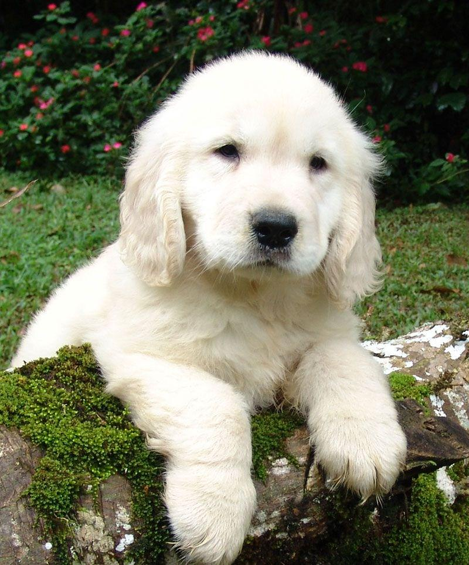

# MiniMax-H3 FL2VA 复现与提交说明

更新时间：2026-11-07 19:31:15 +08:00（北京时间）。

**当前状态：我方完整模型八卡正式生成成功；官方 compare 已执行，但参考端在模型加载前因 GPU 枚举失败退出，结果为 SKIPPED。下面是可复查材料与下一轮执行入口，尚不能作为 compare 成功提交。**

## 复现指令

### 统一输入与参数

统一输入图片：



- 文件：`inputs/first_frame.png`，800×965，SHA-256：`b97c3487ca35da0c803fba3787cf2b7f936d3d4595548ae5b7b576c19934be54`。
- 统一 FL2VA Prompt：**A dog falls asleep**。
- seed=42，num_frames=124，steps=50；不传 height/width，遵循 pipeline 默认分辨率。本次实际输出宽768×高928、24 fps，调度器实际执行49次DiT。
- 模型：`/public/home/aclsylqidf/shared/MiniMax-H3`，下含 FL2VA 和 diffusers；不复制权重到个人AFS。
- 只做 FL2VA；不运行 REF2VA。正式比较入口为未修改的 `InfiniLM/examples/minimax_h3_compare.py`。
- 官方脚本 SHA-256（CRLF归一为LF）：`24f3439e11e98d979ec8cee5f76284079dad87cb4668cf0f109b7904e8641bc3`。
- 双方进程统一关闭 flash/memory-efficient SDPA，使用 math SDPA 并启用 `torch.backends.cuda.allow_fp16_bf16_reduction_math_sdp(True)`。这是精度配置，需要随结果披露；全模型参考一致性仍待测。

### 执行约定与环境

**只用 Git Bash：D:/Apps/git/Git/bin/bash.exe。禁止 PowerShell、pwsh、cmd、WSL shell 及其包装。每次将完整脚本整体 base64 编码后交给 Git Bash 解码；远端 payload 同样整体编码，变量在远端展开。**

本地真实工作目录为 `D:/Desktop/songshan workspace`（有空格），不是 `songshan_workspace`。下面命令在已经打开的 Git Bash 中运行。文档展示的是脚本明文；执行时使用随附的编码入口。

平台环境基线：Python3.11、海光Torch2.9/HIP6.3、gfx936、DTK /opt/dtk、Transformers5.5.0、Hub1.23.0、Diffusers0.40.0、PyAV16.0.1、FlagTree0.7.0+hcu3.6/Triton3.6、NineToothed。`skimage.metrics.structural_similarity`是官方compare额外依赖；本次没有走到指标计算，其可用性由新预检实测，不能提前宣称已满足。

持久资产：

| 用途 | AFS handover 下路径 | 使用方式 |
|---|---|---|
| 已编译源码和安装 | h3-stable/src、h3-stable/install | 现有部署直接复用 |
| 原生对象缓存 | current-batch/h3-stable-build-cache.tar.gz | 1194对象跨租约零重编已验证 |
| Python/JIT运行包 | h3-runtime-v2.tar.xz | 解压至节点工作区；不写AFS临时缓存 |
| 最小编译器包 | hcu-jit-clang18-minimal.tar.gz | 恢复既有JIT缓存；推理禁止实际再编译 |
| ready清单 | h3-runtime-ready.json | 校验运行包、工具链和5份关键源码SHA |
| native正式视频 | current-batch/formal-20261107T0956/formal.mp4 | 仅续跑模式使用官方provided参数 |

ready只表示资产已验收，不能证明某个新实例GPU可计算。既有运行包与AFS环境是复现前提；本说明不是脱离平台的任意Linux环境安装指南。

### 下次执行：恢复已编译资产 → GPU预检 → 官方compare → 回收结果

先准备一个**健康、空闲、剩余至少30分钟的单节点八卡Bash实例**；建议给60分钟，legacy完整耗时尚未测得。以下入口不申请、不释放资源，发现多个候选或过期实例会停止；不硬编码旧workload/sid。仅当终端空闲时执行。

本地 Git Bash 一条命令，默认只补跑缺失的 legacy 参考：

```bash
base64 -w0 < "/mnt/d/Desktop/songshan workspace/handover/scripts/next_h3_compare.sh" | base64 -d | "/mnt/d/Apps/git/Git/bin/bash.exe" --noprofile --norc -s -- resume
```

正式双方重新生成、获取本轮双方性能耗时：

```bash
base64 -w0 < "/mnt/d/Desktop/songshan workspace/handover/scripts/next_h3_compare.sh" | base64 -d | "/mnt/d/Apps/git/Git/bin/bash.exe" --noprofile --norc -s -- full
```

二者只选一个。resume使用已核验native视频，节约一次生成；该侧本轮性能显示n/a，不能计算速度提升，也不能作为从头生成的性能提交。full不传provided视频参数，官方入口依次生成legacy和InfiniLM，再计算指标。

入口完整流程：

1. 用既有API登录态找到唯一八卡Open终端，并验证实际deadline；不重复申请。
2. 只查询 `GET /api/persistent-storage`，不扫盘。需要完整且新鲜的用量快照；41MiB证据预算＋32MiB安全余量，总量不得超过4GiB；快照过期或空间不足立即停止。
3. 小脚本先打成gzip压缩包，再通过终端base64传到节点（完整派发长度校验不超过32KiB输入队列），不向AFS上传新环境，不执行pip/xmake/configure。
4. 恢复运行包并核验ready源码SHA；缓存、日志先写节点目录，禁止实际JIT编译。
5. 核验官方compare和统一图片SHA；直接HIP count=8、Torch count=8，并逐卡执行BF16矩阵乘法。预检图像、PyAV编解码、SSIM和模型库导入。生成子进程也重复设备检查，检查失败以78退出。
6. 双方使用同样math_bf16设置，官方compare源码、公式及参数不变。legacy显式文本卡0–3、transformer卡4–7，placement memory_fraction=0.4；native TP8。
7. 实时打印日志，30秒监视提示；节点保存status.json。失败同样保存证据，终端截断不作为任务成功或失败的判据。
8. 证据不超过40MiB时回收至 `handover/current-batch/h3-submit-时间-随机标识/`，再拉回本地results并逐文件大小/SHA核验。超额则保留节点文件并报错，不能无条件拷贝撑爆AFS。不关闭用户实例。

如自动选择无法使用，可在Git Bash对下面完整脚本整体编码执行，指定**新实例**的连接记录：

```bash
set -euo pipefail
cd "/d/Desktop/songshan workspace"
export IFAB_HOME="/mnt/c/Users/hjh19/.ifab"
python3 -u handover/scripts/launch_h3_compare_submission.py \
  --connection handover/results/新实例连接记录.json --mode resume
```

连接记录需含allocation、sid、最新seq/cursor。网络失步/发送不确定时不自动重发、不自动重开终端；先查看本地results/h3-submit-*/launch.json和节点status。旧 `h3_eight_inference_session.json` 已过时，不可直接重用。

### 从源码编译到运行的全部步骤（首次部署/需要重新构建时）

**当前无需走此分支。** 这是给官方复现列出的源码构建路径，使用既有平台Python环境和已备份运行依赖，首次建立一个节点本地checkout；新wrapper做过本地语法检查，尚未在新租约完整执行。已验证的部署恢复入口是上一节。

将本次 `submit_repo`（源码、scripts、统一图片，不含权重/凭证/二进制）和 `handover/scripts` 中的restore_h3_runtime.py、h3_runtime_env.sh置于节点工作区。在同一平台Python/DTK/Torch ABI环境中执行以下**完整远端Bash脚本**；本地派发仍应将整个脚本base64封装，不能让外层提前展开变量。

```bash
set -euo pipefail
# 当前目录必须是节点工作区，不能是个人AFS根。
export H3_RUNTIME_DIR="$PWD/h3-repro-runtime"
export H3_RUNTIME_ENV="$PWD/handover/scripts/h3_runtime_env.sh"
python3 "$PWD/handover/scripts/restore_h3_runtime.py"
cd "$PWD/submit_repo"
bash --noprofile --norc scripts/build_and_compare_h3.sh
```

`build_and_compare_h3.sh`中的完整构建顺序：

```bash
# 该段由 wrapper 设置好 Python include、pybind11 include、Torch ABI、
# DTK路径、INFINI_ROOT 和 xmake 后执行；完整设置见 scripts/build_hygon.sh。
# BUILD_JOBS=120，BUILD_VERBOSE=1，首次 BUILD_SKIP_CONFIGURE=0。
cd InfiniCore
xmake f -vD -y -m release --ccache=n --hygon-dcu=y \
  --hygon-arch=gfx936 --cuda=/opt/dtk/cuda/cuda \
  --aten=y --ccl=y --ninetoothed=n --omp=n \
  --cxxflags="-D_GLIBCXX_USE_CXX11_ABI=$INFINILM_CXX11_ABI"
for target in infiniop infinirt infiniccl infinicore_cpp_api _infinicore; do
  xmake build -vD -y -j120 "$target"
  xmake install -y "$target"
done
cd ../InfiniLM
xmake f -y -m release --ccache=n --cxx11-abi="$INFINILM_CXX11_ABI"
xmake build -y -j120 _infinilm
xmake install -y _infinilm
cd ..
# wrapper随后设好当前checkout路径，并运行未修改官方compare：
bash --noprofile --norc scripts/run_h3_compare.sh
```

这里编译H3所需的Core和LM目标，不是无条件全仓测试构建；但当前`_infinilm`目标包含公共模型代码，没有独立的“仅H3单文件”target。不能将此描述成只编译一个H3文件。新checkout对象及安装留在节点；现有AFS稳定编译缓存不覆盖。

稳定路径上的续编使用既有 `h3_stable_incremental.sh` 恢复对象、.xmake及相同路径。它默认含“零变更不得重编”防护，是验证脚本，不是任意源码修改后的通用构建入口；`VERIFY_SINGLE_FILE=1`会人为改注释做实验，不能作为提交命令。本轮只有入口脚本变更，native产物不需要重新编译，不能重跑首次构建来代替增量。

### 整理后的文件与验收范围

- `scripts/run_h3_compare.sh`：正式官方入口wrapper，默认双方生成，可通过环境变量显式provided续跑；BF16 math及预检。
- `scripts/h3_preflight.py`、`scripts/h3_compare_hook/sitecustomize.py`：父进程依赖/输入核验及子进程GPU检查，错误停止模型加载。
- `scripts/build_and_compare_h3.sh`：首次源码构建至compare入口，-j120，节点安装，实时日志。
- `../handover/scripts/next_h3_compare.sh`：本地Git Bash一条命令入口；launcher只复用现有会话。
- `../handover/scripts/reproduce_h3_compare.sh`：远端恢复与运行；`persist_h3_submission.py`负责有预算的回收。
- 旧4帧冒烟入口已修正为已验证22帧/256×256/2步，并使用短时长override；**仅冒烟启用override，正式compare不启用**。
- 本轮只做本地语法、SHA和启动hook失败路径验证；未申请新卡、未运行新的legacy或完整compare，不将静态验证写成实机通过。

## 结果

以下逐字摘自 `../handover/results/h3-official-compare-20261107T1017/compare.log`，**这是本次实际结果，不是成功示例**：

```bash
[compare] FL2VA: SKIPPED: reference status=failed, InfiniLM status=provided

[timing comparison] FL2VA
  component                                   PyTorch (s) InfiniLM (s)    speedup
  ------------------------------------------ ------------ ------------ ----------
  process.wall                                     65.056          n/a        n/a

[result] MiniMax-H3 video comparison

  FL2VA: SKIPPED (reference status=failed, InfiniLM status=provided)
```

compare退出码2，参考进程退出码1。参考视频未生成，因此没有SSIM、逐像素差异或全模型数值对齐结论。官方compare即便以后返回0，也只表示流程完成，需看尺寸、帧数、SSIM和差异；不能只凭rc=0写“正确性通过”。

我方正式生成证据另列，不能填成官方compare成绩：

| 项目 | 实际结果 |
|---|---|
| 模型/设备 | 完整模型，原生TP8 |
| 生成参数 | 上述统一输入，124帧/50步请求/seed42 |
| 视频 | H.264，768×928，24fps，124帧，约5.17秒 |
| 音频 | AAC，双声道，32000Hz |
| DiT | 432.086秒；49次调用 |
| pipeline / 加载至保存 | 479.796秒 / 542.131秒，不含Python启动导入 |
| 产物 | ../handover/results/h3-formal-20261107T0956/formal.mp4 |
| SHA-256 | ef0fa80ae779545881c6bc233494c2950c1edc974f0bce985c782582cc19e0ed |

## 官方 compare 为什么没跑起来

准确说，**compare启动并跑到了调度参考进程，但参考生成尚未开始，导致比较阶段跳过**。

```text
legacy minimax_h3.py
  → infinilm.multimodal.audio_kernels
  → infinilm.__init__ / models
  → infinicore.context / device
  → _infinicore.get_device_count
  → cudaGetDeviceCount: error 100
  → infinirtGetAllDeviceCount: Internal Error
  → reference status=failed
  → FL2VA SKIPPED
```

证据链：

1. `output/reference_fl2va.log`显示错误在顶层导入；没有模型权重加载/去噪日志。这次不是显存OOM，也不是prompt、帧数或SSIM公式问题。
2. 去掉sitecustomize后独立进程仍为 `torch.cuda.device_count()=0`。不能把设备消失归因于BF16启动hook。
3. 不经Torch/InfiniCore，直接调用 `/opt/dtk/lib/libamdhip64.so`：
   `DIRECT_HIP 100 no ROCm-capable device is detected 0`。这将阻塞定位到HIP设备枚举/其底层环境。
4. `/dev/kfd`和已测render设备可读写打开，sysfs拓扑可见；四种常见可见设备过滤变量未设置。文件存在不代表GPU计算可用，也没有证据证明是用户误设mask。
5. 平台当时Running/Active、分配8卡，原租约18:31:51到期，而失败约18:18发生。因此不能用“排上了/Active”替代计算检查，也不能把本次解释为正常到期。
6. **尚未确定最底层原因**：驱动状态、设备隔离/映射、HSA初始化或动态库链均需额外证据。不能武断说驱动已坏；需健康新实例复测，或平台侧同时刻日志。

下一轮先执行真实HIP/Torch/逐卡计算，失败立刻停；通过后才跑legacy。仍有未验收风险：legacy模型分片不同于native TP8，BF16 math在其完整注意力上的显存峰值和总耗时尚未测得；SSIM依赖也尚未在该租约实测。即使设备恢复，也不能承诺不存在第二个问题。正式提交前必须补齐实际legacy视频和官方compare完整输出。

原始证据目录：`../handover/results/h3-official-compare-20261107T1017/`；平台状态 `../handover/results/compare-device-loss-platform.json`；本轮本地检查 `../handover/results/h3_submission_static_checks.json`。
